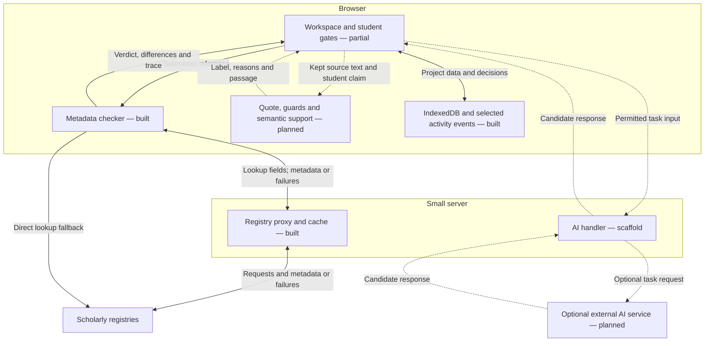

# Alignment review of Nihal's architecture

**Reviewed:** 24 November 2026, Dubai time.

**Input:** the user-supplied screenshot titled “8.1 System architecture”, attributed by the user to Nihal. This review assesses the diagram, not unpublished code on Nihal's branch.

**Repository inspected:** `e57ba771b02f7484ebefecc5a061f27c3680a45f`. Application source and tests at that point are unchanged from `723523c91b2cdcf26b8b9cbdf98e4facfc160df5`. The session fetched `origin`, switched to `hemanth/lab-governance` and merged `origin/main`; Git reported that the branch was already up to date.

## Conclusion

The separation between workspace, research assistance, integrity checks and recorded decisions aligns with Paper Trail's direction. The screenshot needs changes before it can describe this hackathon implementation accurately. Its database layer conflicts with the approved browser-local architecture, and its synthesis wording could imply assignment generation, which the product explicitly excludes. Several other boxes describe planned capabilities rather than working features.

Retain the logical separation. Use the current architecture and the six roles already named in the deck; do not introduce a second, incompatible role vocabulary or a server database through the diagram. Sources: [repository rules](../../CLAUDE.md), [build plan](../BUILD_PLAN.md), [policy roles](../../src/policy/policy.ts), [deck outline](../PHASE1_DECK_OUTLINE.md).

## Component-by-component mapping

| Screenshot component | Alignment and observed status | Accurate wording / action | Repository evidence |
|---|---|---|---|
| Research workspace | Aligned; partially built. Check, Projects, Plan and Find exist. Several later journey pages are stubs. | **Research workspace: built foundation; later journey steps planned.** | [Project shell](../../src/app/ProjectShell.tsx), [Check](../../src/pages/Check.tsx), [Plan](../../src/pages/Plan.tsx), [Find](../../src/pages/Find.tsx) |
| Research workflow engine | Aligned as a responsibility. Current behavior is distributed across pages and actions; there is no separate general orchestration service. | **Workflow and student checkpoints.** Name plan approval, source selection and planned claim review. | [Actions](../../src/store/actions.ts), [policy](../../src/policy/policy.ts), [Evidence stub](../../src/pages/Evidence.tsx) |
| Research project manager | Project/source storage and AI-level selection exist; the full library interface is planned. | **Local project state and assessment settings.** “Permissions” must not imply user accounts, access-control roles or verified institutional authorization. | [Database](../../src/store/db.ts), [contracts](../../src/core/contracts.ts), [Library stub](../../src/pages/Library.tsx) |
| Discovery agent under AI services | Needs a split. AI may suggest queries; code retrieves registry records. Current Plan suggestions use string processing. | **Planner: search suggestions, AI planned. Scout: registry retrieval by code, built.** | [Plan](../../src/pages/Plan.tsx), [registry clients](../../src/core/registries/index.ts), [role definitions](../../src/policy/policy.ts) |
| Paper analyst | Aligned with planned Reader and evidence inspection. | **Reader: select existing passages; code checks quotations.** Do not describe generated wording as source text. | [Nihal tasks 1–5 and 7](../team/NIHAL.md), [Passage and ClaimChecks contracts](../../src/core/contracts.ts) |
| Synthesis agent: construct research arguments | Potential product conflict. The approved product does not write the student's assignment. | **Organise evidence; the student constructs the argument and writes.** Keep source-linked summaries or comparisons within assessment permission and their actual implementation. | [Product rules](../../CLAUDE.md), [build plan section 3](../BUILD_PLAN.md), [Siddal's Write task](../team/SIDDAL.md) |
| Adversarial reviewer | Aligned with planned Challenger. | **Challenger: seek contrary evidence and flag overclaims.** It does not edit/delete claims or approve on the student's behalf. | [Policy role](../../src/policy/policy.ts), [Yash's Challenger task](../team/YASH.md), [Nihal's gateway task](../team/NIHAL.md) |
| Metadata verifier | Strong alignment; built. | **Compare supplied fields with returned registry metadata; show verdict, differences and trace.** This does not verify scientific truth or claim support. | [Verifier](../../src/core/verify/verdict.ts), [comparison code](../../src/core/verify/compare.ts), [receipt](../../src/ui/Receipt.tsx) |
| Evidence verifier | Aligned but planned. It combines deterministic quotation/guard checks with a semantic-support assessment. | **Quote and rule checks + semantic support; final label set by code.** It is not an entirely deterministic proof of truth. | [Nihal tasks 1–4](../team/NIHAL.md), [claim contracts](../../src/core/contracts.ts), [policy thresholds](../../src/policy/policy.ts) |
| Publication monitor: retractions and corrections | Overstates the current scope. Available retraction flags are read during lookups. There is no continuous publication monitor or general correction-tracking implementation. | **Retraction metadata lookup, with coverage limits.** Broader monitoring is a separate proposal for Yash. | [Registry mapping](../../src/core/registries/map.ts), [verifier](../../src/core/verify/verdict.ts) |
| Citation renderer | Aligned with planned Clerk/citation engine. It is code, not a generative agent. | **Format eligible source records; apply the agreed export policy.** The approved-exception path still needs reconciliation with the deck's strict rule. | [Siddal's brief](../team/SIDDAL.md), [exportable](../../src/core/contracts.ts), [citable](../../src/store/actions.ts), [Export stub](../../src/pages/Export.tsx) |
| Research data: PostgreSQL, PDF storage, full-text and vector indexes | Conflicts with the current architecture if shown as the hackathon build. Storage is Dexie/IndexedDB. Server uploads and accounts are excluded. Local PDF reading is planned; a persistent PDF store or vector index is not established by the source-text field. | **Local project data: IndexedDB; planned local document and passage processing.** Remove PostgreSQL and server PDF storage from this deck. Any change of storage architecture belongs to Yash and needs an explicit new decision. | [Rules](../../CLAUDE.md), [database](../../src/store/db.ts), [Source contract](../../src/core/contracts.ts), [Yash's PDF task](../team/YASH.md) |
| Audit infrastructure | Aligned; only the foundation is built. Selected events are hash-linked. Complete search, AI and decision coverage is not yet established. | **Local activity log and evidence records; disclosure/reporting planned.** Chain verification checks supplied entries, not completeness or external activity. | [Log](../../src/log/log.ts), [actions](../../src/store/actions.ts), [Find](../../src/pages/Find.tsx), [AiStatement stub](../../src/pages/AiStatement.tsx) |
| Research output | Metadata receipts exist. Evidence-linked student writing, formatted exports and the faculty evidence report are planned. | **Checked metadata receipts; planned student-authored writing, references and evidence report.** Preserve unresolved/unchecked items in the report. | [Receipt](../../src/ui/Receipt.tsx), [Write](../../src/pages/Write.tsx), [Export](../../src/pages/Export.tsx), [Yash's report task](../team/YASH.md) |

## What “independent integrity services” should mean

Use this phrase to describe separation from generative suggestions. The metadata checker is implemented without an AI dependency. The planned claim pipeline is different: exact quotation, number, direction and scope checks use code, while semantic support includes an uncertain inference result. Code combines those inputs into a label. A matching quotation does not by itself establish that a paraphrase is supported, and source support does not establish that the underlying research is correct. [Verifier](../../src/core/verify/verdict.ts), [Nihal's brief](../team/NIHAL.md), [claim labels](../../src/core/contracts.ts).

The word “services” should not imply separately deployed microservices, a separate organization or independently certified results. Current checking runs in the browser, supported by a small registry proxy; the AI handler is still a scaffold. [Server router](../../server/router.mjs), [registry handler](../../server/handlers/registry.mjs), [AI handler](../../server/handlers/ai.mjs).

The screenshot's “Core differentiator” badge describes a proposed emphasis, not demonstrated market uniqueness. Our competitor audit found source evidence, human review, retraction warnings and audit capabilities elsewhere. A defensible claim is: **Paper Trail aims to make checks, uncertainty and student decisions visible in one assessment-focused workflow.** Comparative superiority still needs measured evidence. [Research audit](RESEARCH_AUDIT.md#competitor-features-keep-the-comparison-specific).

## Corrected architecture for discussion

This diagram shows responsibilities and data paths. It is not evidence of a completed end-to-end journey. Boxes state their implementation status; dotted arrows are planned. The existing slide 3 remains the submission-oriented architecture specification.

Keep the three student gates explicit in the workflow slide: approve the plan, keep/skip sources, and accept/rewrite/reject claims. Preserve the six agreed roles: Planner, Scout, Checker, Reader, Challenger, Clerk. Source retrieval and metadata verification remain available without a generative service. Claim review, successful AI tasks and export must retain their planned labels until implemented and tested. [Deck](DECK.md), [policy roles](../../src/policy/policy.ts), [build plan](../BUILD_PLAN.md).

## Ideas worth carrying forward

| Idea | Practical incorporation | Owner / evidence required |
|---|---|---|
| Separate suggestions from check results | A candidate suggestion cannot assign a metadata verdict or an approval key. Every result opens its evidence and limitations. | Nihal/Yash own the runtime boundaries; Hemanth can explain and exercise them in the Lab. Check both permitted and attempted bypass paths. |
| Connect evidence to the student's decision | Show the submitted fields or claim, checked record/passage, unavailable checks, time and student action together. | Existing Check receipts provide a starting point. Nihal owns claim inspection; Hemanth owns Lab and disclosure; Siddal owns export. |
| Treat unavailable work as visible output | Keep Could not check, missing passages, uncertain support and unrun cases visible. A partial outage must not silently imply full coverage. | Shared behavior is a Yash/Nihal decision; Hemanth reports the actual results without replacing core verdicts. |
| Make review controls explorable | Let users open a result's detail, return to its row and understand the next action with a keyboard or a narrow screen. | Implement within owned pages, reuse existing tokens, and record actual usability/accessibility checks. This is proposed behavior, not an observed test result. |

Do not copy the screenshot's styling into the application. The brief requires the existing tokens, square corners, 1px borders, Marcellus headings and Public Sans text. Its green differentiation badge would use green for a claim other than a proven result; remove it. Avoid pill badges and the screenshot's rounded panel treatment. [User design brief](../team/HEMANTH.md), [tokens](../../src/ui/tokens.css).

## Decisions and ownership

- **Yash:** confirm the browser-local architecture, reconcile strict export versus reasoned exceptions with Siddal, and define partial-registry/retraction coverage wording. Shared storage, contracts and registry behavior remain his files.
- **Nihal:** implement the planned quote/guard/support pipeline and fixed AI tasks within his brief. Keep semantic uncertainty visible and student approval separate.
- **Siddal:** implement citation rendering, student writing and export preflight in his owned files, following the agreed exception policy.
- **Hemanth:** maintain the deck's status labels, the integrity evaluation, House rules and the event-derived statement. This alignment review changes documentation only.

No implementation on another branch was inspected or changed for this comparison. No new database, dependency, deployment or product capability is introduced by this note. The required review after the deck draft remains in place; this screenshot review does not imply approval to begin later implementation tasks.
