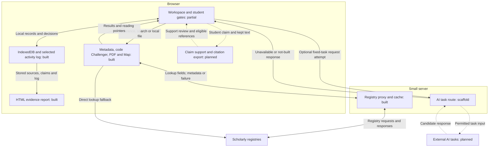

# Alignment review of Nihal's architecture

**Reviewed:** 25 November 2026, Dubai time. This update supersedes the implementation-status assessment from 24 November.

**Input:** the user-supplied screenshot titled “8.1 System architecture”, attributed by the user to Nihal. This is a review of that diagram against the repository, not an assessment of unpublished work on Nihal's branch.

| Baseline | Commit and meaning |
|---|---|
| Current `origin/main` | `7b0391ff0ec90e8b8f9fd2a030845cc42d3a753d`. Its application changes are present on `hemanth/lab-governance` after the session's merge of main. |
| Newer `origin/yash/integration` | `59a876d6acf9fbdc6ea2a71697a0f6f16e16dcd5`. Two further commits were inspected separately; they were **not merged or cherry-picked into Hemanth's branch**. |
| Meaning of “implemented” below | Present in the inspected source. It does not mean deployed, observed in a live browser, or proven through an end-to-end assessment journey. Actual verification is recorded in [the repository update](REPO_UPDATE_2026-11-25.md#verification-performed). |

## Conclusion

The screenshot's separation of research assistance, integrity checks, student decisions and audit records remains useful. Current main now implements more of that direction: a code Challenger, a metadata-based map, local PDF text extraction, an HTML evidence report, and navigation aids. The screenshot still needs corrections before it describes the hackathon build accurately. PostgreSQL and server PDF storage conflict with the approved browser-local architecture; argument generation conflicts with the requirement that students write their own assignments; several evidence and citation features remain planned.

Use the diagram as a map of responsibilities. It is not a collection of independently deployed services. Preserve the six agreed roles—Planner, Scout, Checker, Reader, Challenger and Clerk—and distinguish implemented code from optional AI tasks whose server handler still returns an unavailable/not-built response. Sources: [repository rules](../../CLAUDE.md), [build plan](../BUILD_PLAN.md), [roles](../../src/policy/policy.ts), [AI handler](../../server/handlers/ai.mjs).

### User-experience overlay and Hemanth's branch

The [new experience ledger](USER_EXPERIENCE_RESEARCH.md) strengthens the case for diagnostic errors, preserved evidence, predictable navigation and explicit data-transfer limits. It does not establish a unique integrity service or a reliability ranking. The screenshot should show the student gates and evidence handoffs, including failure and recovery paths, rather than implying that each named service is independently deployed or complete.

The owned Lab implementation is an additional browser inspection route on `hemanth/lab-governance`. It reuses the shared checker and registry client; it does not introduce a new verifier, database or AI service. [Measured recorded results](LAB_RESULTS.md) and [validation](VALIDATION.md) distinguish its execution evidence from live/browser checks still required. The component table below continues to describe the separately identified main snapshot.

Two implementation limits belong beside the live-check arrow: the client can reuse in-memory responses, and the shared checker cannot abort a request on a caller's signal. The Lab stops scheduling and ignores late responses; retrieval freshness and actual transport cancellation need Yash's shared-code support. [Registry transport](../../src/core/registries/http.ts), [checker signature](../../src/core/verify/verdict.ts), [Lab runner](../../src/core/lab/runner.ts).

## Component-by-component mapping

Unless a row explicitly says **integration only**, its implementation status refers to current main.

| Screenshot component | Observed status and qualification | Wording or action for the team | Repository evidence |
|---|---|---|---|
| Research workspace | Projects, Plan, Find and Check have implementations; Challenge and Map now also have implementations. Library, Evidence, Ask, Write and Export remain stubs. | **Research workspace: several working components; full journey unfinished.** | [Project shell](../../src/app/ProjectShell.tsx), [Challenge](../../src/pages/Challenge.tsx), [Map](../../src/pages/Map.tsx), [Library](../../src/pages/Library.tsx), [Evidence](../../src/pages/Evidence.tsx), [Ask](../../src/pages/Ask.tsx), [Write](../../src/pages/Write.tsx), [Export](../../src/pages/Export.tsx) |
| Workflow engine: orchestration, agent roles and checkpoints | Pages and store actions coordinate the flow; there is no separate general orchestration service. Plan approval and source selection exist; claim review is planned. | **Workflow and student checkpoints.** Show approve plan, keep/skip sources, then planned accept/rewrite/reject claims. | [Plan](../../src/pages/Plan.tsx), [Find](../../src/pages/Find.tsx), [actions](../../src/store/actions.ts), [Evidence](../../src/pages/Evidence.tsx) |
| Project manager: libraries, notes, permissions and state | IndexedDB stores projects and sources; source data supports notes/tags/folders. The full Library interface is unfinished. The AI level is a student's declaration, not authenticated institutional permission. | **Local project data and declared assessment settings.** Do not imply accounts, shared-library permissions or a verified instructor authorization service. | [Database](../../src/store/db.ts), [contracts](../../src/core/contracts.ts), [actions](../../src/store/actions.ts), [Library](../../src/pages/Library.tsx) |
| AI services: Discovery | Scout retrieval is implemented as registry code. Plan can attempt a fixed AI request and validate returned search phrases; code supplies a fallback. A successful AI gateway task is not implemented. | **Planner: optional AI request path with code fallback. Scout: registry retrieval by code.** Do not call registry results generated references. | [Plan](../../src/pages/Plan.tsx), [AI client](../../src/core/aiClient.ts), [registries](../../src/core/registries/index.ts), [AI handler](../../server/handlers/ai.mjs) |
| AI services: Paper analyst | The Reader, evidence review and Ask pages remain planned. Local PDF extraction and Challenger sentence selection are implemented, but do not complete the Reader. | **Reader planned: select existing passages and assess support within permission.** | [Nihal's brief](../team/NIHAL.md), [Evidence](../../src/pages/Evidence.tsx), [Ask](../../src/pages/Ask.tsx), [PDF reader](../../src/core/pdf/read.ts), [Challenger code](../../src/core/challenge/challenge.ts) |
| AI services: Synthesis / construct research arguments | The wording risks promising assignment generation. The product requires student-authored writing; Write is still a stub. | **Organise and compare evidence; the student constructs the argument and writes.** Any future synthesis aid must remain within the agreed permission and actual implementation. | [Rules](../../CLAUDE.md), [build plan](../BUILD_PLAN.md), [Write](../../src/pages/Write.tsx), [Siddal's brief](../team/SIDDAL.md) |
| AI services: Adversarial reviewer | A code Challenger searches for alternative findings, selects existing sentences and flags possible overclaims. It is a reading aid. **Integration only:** added subject/outcome checks reduce several tested mismatches; this remains a lexical heuristic. | **Challenger: seek contrary evidence and suggest reading checks.** It does not establish semantic support, scientific truth or a final claim label. | [Challenge page](../../src/pages/Challenge.tsx), [main algorithm](../../src/core/challenge/challenge.ts), [integration algorithm](https://github.com/Yashpetkar7/Ai-Club-Hackathon/blob/59a876d6acf9fbdc6ea2a71697a0f6f16e16dcd5/src/core/challenge/challenge.ts) |
| Integrity services: Metadata verifier | Implemented: code compares supplied fields with a returned registry record and exposes verdict, differences and trace. Main can still confirm a matching record when the secondary registry fails. **Integration only:** that clean-match outage path becomes neutral “One registry only.” | **Metadata comparison with visible coverage.** Neither branch proves independent agreement of every field across registries; a secondary no-record response can still allow Confirmed. | [Main verifier](../../src/core/verify/verdict.ts), [comparison](../../src/core/verify/compare.ts), [integration verifier](https://github.com/Yashpetkar7/Ai-Club-Hackathon/blob/59a876d6acf9fbdc6ea2a71697a0f6f16e16dcd5/src/core/verify/verdict.ts), [integration tests](https://github.com/Yashpetkar7/Ai-Club-Hackathon/blob/59a876d6acf9fbdc6ea2a71697a0f6f16e16dcd5/tests/unit/verify.test.ts) |
| Integrity services: Evidence verifier / passage and claim support | The full claim pipeline is planned. Challenger's exact text slices do not implement the planned quotation, number, direction, scope and semantic-support pipeline. | **Planned: exact quotation and rule checks plus uncertain semantic support; code sets the final label.** A source containing words is different from a source supporting the student's paraphrase. | [Nihal's brief](../team/NIHAL.md), [claim contracts](../../src/core/contracts.ts), [Evidence](../../src/pages/Evidence.tsx), [Challenger](../../src/core/challenge/challenge.ts) |
| Integrity services: Publication monitor | Available retraction flags are read during registry lookups. No continuous monitor or general correction-tracking service is implemented. | **Retraction metadata lookup, with registry coverage limits.** Monitoring is a separate proposal. | [Registry mapping](../../src/core/registries/map.ts), [verifier](../../src/core/verify/verdict.ts) |
| Integrity services: Citation renderer | Citation rendering and the Export journey remain planned. The new evidence report lists sources and their stored status; it is not formatted citation export. Strict three-key eligibility and the reasoned-exception helper remain inconsistent. | **Planned Clerk: format eligible source records under an agreed export policy.** Resolve exceptions before describing the rule as universally enforced. | [Export](../../src/pages/Export.tsx), [exportable contract](../../src/core/contracts.ts), [citable helper](../../src/store/actions.ts), [report](../../src/core/report/report.ts) |
| Research data: PostgreSQL | Conflicts with this build. Application data is stored in browser IndexedDB through Dexie. | Replace with **Local project data: IndexedDB**. A server database would require a new architecture decision from Yash. | [Rules](../../CLAUDE.md), [database](../../src/store/db.ts) |
| Research data: PDF storage | PDF bytes are read locally; extracted text can be stored on the source. There is no server PDF store. Metadata lookup can send an extracted DOI/title, or a filename-derived query, to registries. | **Local PDF extraction and source text.** Avoid “nothing leaves the device.” The current reader processes at most 80 pages but reports total pages as “pages read”; that needs correction. | [PDF reader](../../src/core/pdf/read.ts), [PDF component](../../src/ui/PdfDrop.tsx), [database](../../src/store/db.ts) |
| Research data: full-text / vector indexes | A source-text field is implemented; a dedicated full-text index or vector index is not established by these sources. Map edges use registry reference lists and shared references. | **Stored source text and metadata links.** Do not label the map a vector search engine or proof of agreement. | [Source contract](../../src/core/contracts.ts), [database](../../src/store/db.ts), [graph construction](../../src/map/graph.ts) |
| Audit infrastructure: searches, provenance, AI activity and approvals | Selected actions are hash-linked; source checks retain a trace. Main now has an AI client and HTML report. **Integration only:** source edits, skips and Plan suggestion decisions gain additional events. Coverage remains incomplete; changed Plan suggestions are not accurately represented by the current decision event. | **Local evidence records and recorded activity.** Neither hash validity nor an event count proves a complete history. The full AI-use statement page is still planned. | [Log](../../src/log/log.ts), [AI client](../../src/core/aiClient.ts), [report](../../src/core/report/report.ts), [AiStatement](../../src/pages/AiStatement.tsx), [integration actions](https://github.com/Yashpetkar7/Ai-Club-Hackathon/blob/59a876d6acf9fbdc6ea2a71697a0f6f16e16dcd5/src/store/actions.ts), [integration Plan](https://github.com/Yashpetkar7/Ai-Club-Hackathon/blob/59a876d6acf9fbdc6ea2a71697a0f6f16e16dcd5/src/pages/Plan.tsx) |
| Output: verified metadata | Receipts and check results are implemented, with the coverage qualifications above. | **Checked metadata, differences and lookup trace.** Confirmed metadata does not establish that a paper's conclusions are true. | [Receipt](../../src/ui/Receipt.tsx), [verifier](../../src/core/verify/verdict.ts) |
| Output: evidence-linked writing and references | The complete evidence-to-writing-to-citation journey is unfinished. | **Planned: source-linked student writing and formatted references.** | [Evidence](../../src/pages/Evidence.tsx), [Write](../../src/pages/Write.tsx), [Export](../../src/pages/Export.tsx) |
| Output: audit report | An HTML evidence report builder and download control are now implemented. It displays stored sources, claims and selected log events. It does not rerun checks, establish log completeness, or complete Hemanth's disclosure page. | **Evidence report from the current local records.** Report gaps and unavailable checks explicitly. | [Report builder](../../src/core/report/report.ts), [download control](../../src/app/ProjectShell.tsx), [AiStatement](../../src/pages/AiStatement.tsx) |

## What “independent integrity services” means here

The separation is logical: generative suggestions do not get to declare their own correctness. Metadata checking currently runs without an AI dependency. The planned claim pipeline combines code checks with a semantic-support inference, then code assigns a label. Exact quotation matching can establish that selected text exists; it cannot establish by itself that a paraphrase faithfully reflects the text or that the research is correct. [Verifier](../../src/core/verify/verdict.ts), [Nihal's brief](../team/NIHAL.md), [claim contracts](../../src/core/contracts.ts).

“Services” must not imply separately deployed microservices, external certification or independently verified organizations. The current architecture uses browser modules and a small server router with registry and AI routes. The registry route is implemented. The AI route checks the requested task and declared level, but still returns an unavailable/not-built response instead of a successful task result. Integration adds request validation and a rate limit; it does not authenticate the school's permission or implement the AI tasks. [Router](../../server/router.mjs), [registry handler](../../server/handlers/registry.mjs), [AI handler](../../server/handlers/ai.mjs), [integration guard](https://github.com/Yashpetkar7/Ai-Club-Hackathon/blob/59a876d6acf9fbdc6ea2a71697a0f6f16e16dcd5/server/guard.mjs).

## Current architecture for discussion

The diagram below describes **current main**, not the newer integration branch. Solid arrows describe implemented data paths in source; dotted arrows describe planned work. “Built” means implemented source, not a deployment or browser test result.

Sources for these paths: [registry client](../../src/core/registries/http.ts), [registry search](../../src/core/registries/index.ts), [PDF component](../../src/ui/PdfDrop.tsx), [AI client](../../src/core/aiClient.ts), [AI handler](../../server/handlers/ai.mjs), [local database](../../src/store/db.ts), [report](../../src/core/report/report.ts). PDF bytes are not uploaded by the implemented reader; lookup fields may leave the browser. Future successful AI tasks would create another data boundary and must be disclosed when implemented.

Keep the three student gates visible in the workflow: approve the plan, keep/skip sources, and the **planned** accept/rewrite/reject claim gate. The six agreed roles remain the vocabulary for the deck even though some roles have only partial or planned implementations. [Deck outline](../PHASE1_DECK_OUTLINE.md), [policy roles](../../src/policy/policy.ts), [Evidence](../../src/pages/Evidence.tsx).

## Differentiation and team decisions

The screenshot's “Core differentiator” badge is a proposed product emphasis, not evidence of market uniqueness. The competitor audit identifies existing source-evidence, review, warning and audit functions elsewhere. A defensible ambition is: **make checks, missing coverage and student decisions easy to inspect within an assessment-focused workflow.** Comparative superiority needs measured results. [Research audit](RESEARCH_AUDIT.md#competitor-features-keep-the-comparison-specific).

| Decision or opportunity | Owner and concrete next step |
|---|---|
| Preserve local storage and student authorship | Yash confirms the architecture; Siddal keeps Write student-authored. Do not add PostgreSQL, uploads or generated assignments through a diagram. |
| Distinguish partial coverage from confirmation | Yash decides and tests the intended meaning of a secondary no-record response and conflicting metadata. Integration handles a secondary outage, but does not compare two complete records for agreement. |
| Resolve citation exceptions | Yash and Siddal reconcile `exportable`, `citable`, report wording and future export preflight. A written reason must not silently masquerade as verified metadata. |
| Make disclosure auditable | Yash supplies durable suggestion/request identity and accurate kept/changed/rejected lifecycle events; Nihal logs task outcomes. Hemanth derives statements only from those supported events and marks missing evidence as unknown. |
| Show what was actually read | Yash exposes PDF pages processed, total pages and truncation; Nihal preserves passage provenance. Hemanth carries those limits into the statement and Lab. |
| Demonstrate navigation and review quality | Each owner checks the real pages by keyboard, at 375 px and with accessibility tooling. Navigation components alone do not establish usability. |
| Complete Hemanth's work within review gates | Hemanth maintains the deck and these source-backed notes, then implements the Lab, governance and statement after the required deck review. This note does not mark those tasks complete. |

Detailed branch differences, remaining risks and proposed owner tests are in [the 25 November repository update](REPO_UPDATE_2026-11-25.md). No application code, other owner's files, dependency or deployment is introduced by this alignment review.

Do not copy the screenshot's rounded panels or green differentiation badge into the application. Follow existing tokens, square corners, 1px lines, Marcellus headings and Public Sans text. Green is reserved for proven results. [Hemanth's design brief](../team/HEMANTH.md), [tokens](../../src/ui/tokens.css).
